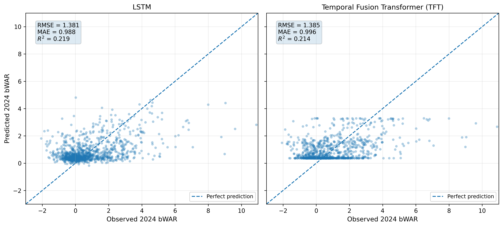
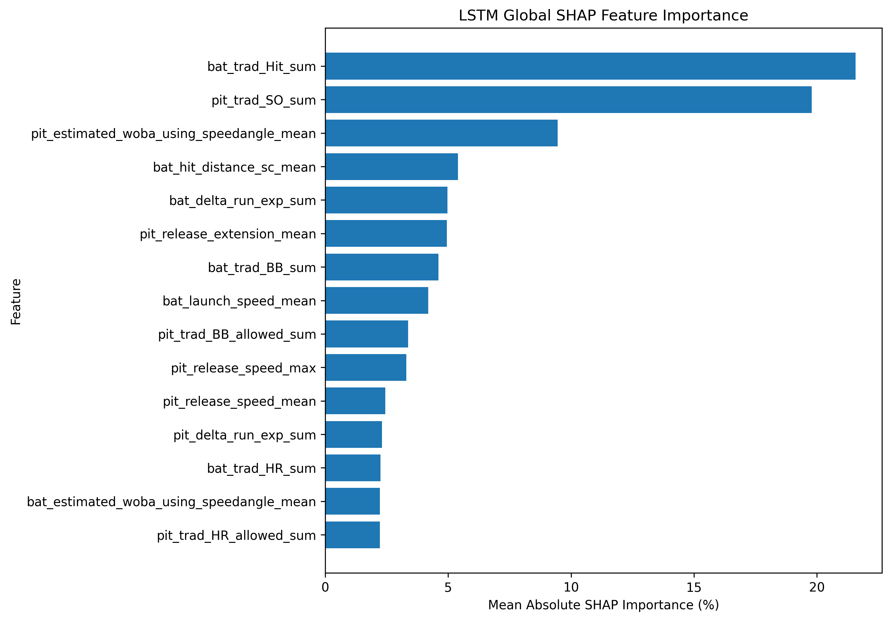
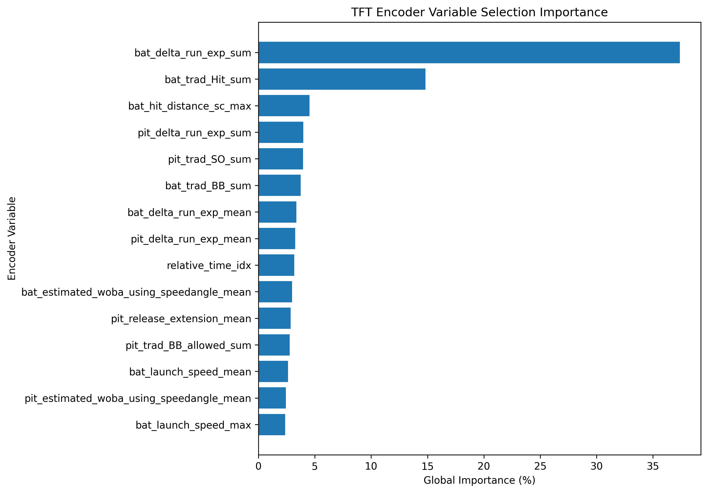
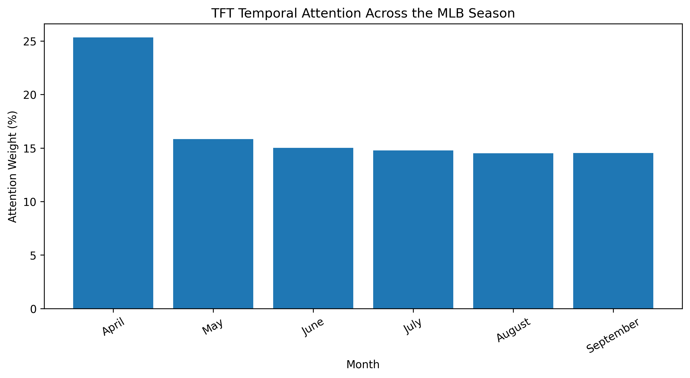

# MLB Subsequent-Season bWAR Forecasting

An interpretable machine-learning framework for forecasting MLB players'
subsequent-season Baseball-Reference Wins Above Replacement (bWAR).

This repository contains the final implementation of my MSc Business Analytics
dissertation. The project integrates Statcast event-level data with historical
bWAR outcomes, represents each player-season as six monthly observations
(April–September), and compares classical machine-learning and deep-learning
models under a chronological out-of-time evaluation design.

## Project highlights

- **Predictor seasons:** 2015–2023
- **Target seasons:** 2016–2024 bWAR
- **Final observations:** 9,610 player-seasons
- **Sequence length:** 6 monthly observations per player-season
- **Feature selection:** 26 candidate predictors → 20 retained predictors
- **Training period:** 2015–2020
- **Validation period:** 2021–2022
- **Held-out test:** 2023 predictors → 2024 bWAR
- **Models:** Ridge Regression, Random Forest, LSTM, Temporal Fusion Transformer
- **Interpretability:** LSTM SHAP and TFT variable-selection / temporal attention

## Final held-out test results

| Model | RMSE | MAE | R² |
|---|---:|---:|---:|
| **Ridge Regression** | **1.373442** | 0.992555 | **0.227437** |
| LSTM | 1.380756 | **0.988436** | 0.219187 |
| Temporal Fusion Transformer | 1.385182 | 0.996271 | 0.214173 |
| Random Forest | 1.402113 | 1.004001 | 0.194846 |

All four models were evaluated globally on the same **1,106 held-out
player-season observations**.

The results show that greater model complexity did not consistently improve
out-of-time forecasting accuracy. Ridge Regression achieved the lowest RMSE
and highest R², while the LSTM achieved the lowest MAE.

## Methodology

The modelling pipeline follows a strictly chronological design to reduce
look-ahead bias.

1. Statcast events are aggregated into monthly player-level features from April through September.
2. Monthly features are aligned with each player's bWAR in the following season.
3. Feature selection is performed using the training period only.
4. Models are trained on 2015–2020 predictor seasons.
5. 2021–2022 is used for validation and model selection.
6. 2023 predictors are used as the final out-of-time test set for 2024 bWAR.

The final input tensor contains:

    9,610 player-seasons × 6 months × 20 features

## Model interpretability

### LSTM SHAP

SHAP was used to estimate feature contributions for the LSTM over the held-out
test data.

Separate batter and pitcher views are also available:

- [LSTM SHAP — batters](data/visualizations/lstm_shap_batters.png)
- [LSTM SHAP — pitchers](data/visualizations/lstm_shap_pitchers.png)

### Temporal Fusion Transformer

The TFT provides native interpretability through variable-selection networks
and temporal attention.

#### Encoder variable importance

#### Temporal attention

Additional static-variable importance:

[TFT static variable importance](data/visualizations/tft_static_vsn_importance.png)

## Repository structure

    .
    ├── README.md
    ├── requirements.txt
    ├── notebooks/
    │   └── 01_end_to_end_pipeline.ipynb
    ├── models/
    │   └── tft_dissertation.ckpt
    └── data/
        ├── README.md
        └── visualizations/
            ├── model_comparison_scatter_final.png
            ├── lstm_shap_global_importance.png
            ├── lstm_shap_batters.png
            ├── lstm_shap_pitchers.png
            ├── tft_encoder_vsn_importance.png
            ├── tft_static_vsn_importance.png
            └── tft_temporal_attention.png

## Data

The raw Statcast files are not included in this repository because the complete
local dataset is several gigabytes in size.

The pipeline expects annual Statcast CSV files for 2015–2023 together with
local Baseball-Reference batting and pitching WAR files.

See [`data/README.md`](data/README.md) for the expected filenames and local
directory structure.

A local Chadwick player-ID mapping cache is created automatically after the
first successful lookup so that the registry does not need to be downloaded
again for every season.

Generated processed datasets and local caches are excluded from Git through
`.gitignore`.

## Reproducibility

The main notebook contains the cleaned final dissertation pipeline:

[`notebooks/01_end_to_end_pipeline.ipynb`](notebooks/01_end_to_end_pipeline.ipynb)

The repository was validated by executing the complete notebook from beginning
to end. The reproduced held-out metrics match the final dissertation results.

The original environment used **Python 3.9.6**. Exact package versions are
provided in [`requirements.txt`](requirements.txt).

Install dependencies with:

    pip install -r requirements.txt

### TFT checkpoint

The dissertation TFT checkpoint is included at:

    models/tft_dissertation.ckpt

By default, the notebook uses:

    RETRAIN_TFT = False

This loads the dissertation checkpoint and reproduces the reported TFT test
metrics.

Setting:

    RETRAIN_TFT = True

will train a new TFT model instead. Because deep-learning training can exhibit
small numerical or hardware-dependent variation, a newly trained checkpoint
may not reproduce the dissertation metrics exactly.

## Technologies

Python · pandas · NumPy · scikit-learn · PyTorch · PyTorch Forecasting ·
Lightning · SHAP · Statcast · Baseball-Reference

## Key takeaway

On this dataset, the simpler Ridge Regression baseline produced the strongest
overall held-out RMSE and R², while more complex sequential models provided
additional temporal and feature-level interpretability rather than a clear
predictive-accuracy advantage.
